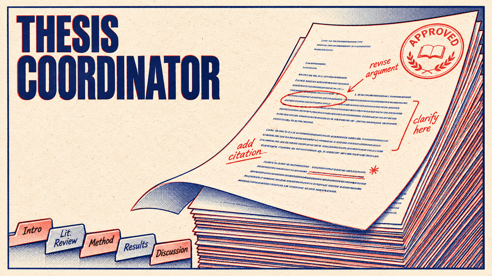

  

  <h1>Thesis Coordinator</h1>
  
<strong>Bachelor thesis supervision and defense management</strong>

  

    
    
    
    
  

Thesis Coordinator consolidates topic proposals, draft reviews, similarity checks, defense scheduling, and committee grading into a single workflow for students, supervisors, committees, and faculty administrators, replacing scattered email threads and manual spreadsheets.

## Documentation

<strong>Getting Started</strong>

| Document | Description |
|----------|-------------|
| [Overview](docs/getting-started/index.md) | Documentation home and navigation |
| [Installation](docs/getting-started/installation.md) | Setup Docker, PostgreSQL, MinIO, and environment variables |
| [Configuration](docs/getting-started/configuration.md) | Google OAuth, SMTP, and storage credentials |
| [Quickstart](docs/getting-started/quickstart.md) | Run the full stack locally with Docker Compose |

<strong>Architecture</strong>

| Document | Description |
|----------|-------------|
| [Overview](docs/architecture/index.md) | System boundaries and design |
| [High-Level](docs/architecture/high-level.md) | Next.js, Socket.io, PostgreSQL, and MinIO components |
| [Data Model](docs/architecture/data-model.md) | Core entities and relationships |
| [Database Schema](docs/architecture/database-schema.md) | Prisma schema and table definitions |
| [Thesis Workflow](docs/architecture/thesis-workflow.md) | Topic approval, supervision, and defense stages |
| [Real-time Events](docs/architecture/realtime.md) | Socket.io events for quota, messaging, and live grading |
| [File Storage](docs/architecture/file-storage.md) | Private MinIO buckets and signed authorization |
| [PDF Generation](docs/architecture/pdf-generation.md) | Assignment and defense minutes rendering |

<strong>Features</strong>

| Document | Description |
|----------|-------------|
| [Overview](docs/features/index.md) | Product capabilities and workflow stages |
| [Authentication & Profile](docs/features/authentication-profile.md) | Google sign-in, study groups, and coordinator quotas |
| [Topic Proposal](docs/features/topic-proposal.md) | Coordinator filtering and proposal submission |
| [Approval & Deadlines](docs/features/approval-deadlines.md) | Approve, reject, or request revisions |
| [Private Messaging](docs/features/private-messaging.md) | Supervisor-student chat with attachments |
| [Files & Submissions](docs/features/files-submissions.md) | Versioned PDF and ZIP uploads |
| [Review & Similarity](docs/features/review-similarity.md) | Chapter annotation and text comparison |
| [Defense Scheduling](docs/features/defense-scheduling.md) | Slot assignment and committee conflict checks |
| [Defense File](docs/features/defense-file.md) | Dossier verification and correction |
| [Live Gradebook](docs/features/live-gradebook.md) | Committee grading and defense minutes PDF |

<strong>Development</strong>

| Document | Description |
|----------|-------------|
| [Overview](docs/development/index.md) | Contribution and engineering conventions |
| [Coding Style](docs/development/coding-style.md) | TypeScript, Next.js, and Prisma conventions |
| [Testing](docs/development/testing.md) | Unit, integration, and end-to-end tests |
| [Project Structure](docs/development/project-structure.md) | Directory layout and module boundaries |
| [Team Responsibilities](docs/development/team-responsibilities.md) | Scope split across three developers |

<strong>Deployment & Operations</strong>

| Document | Description |
|----------|-------------|
| [Docker Compose](docs/deployment/docker-compose.md) | Container setup and Cloudflare Tunnel |
| [CI/CD](docs/deployment/ci-cd.md) | GitHub Actions pipeline |
| [Backups](docs/operations/backups.md) | PostgreSQL nightly automated backups |

<strong>Security & Compliance</strong>

| Document | Description |
|----------|-------------|
| [Overview](docs/security-compliance/index.md) | Security and compliance boundaries |
| [Security](docs/security-compliance/security.md) | Signed authorization and role guards |
| [Privacy](docs/security-compliance/privacy.md) | Data handling and user privacy |

## License

All project source code, APIs, and scripts are licensed under the [GNU Affero General Public License v3.0](LICENSE).
