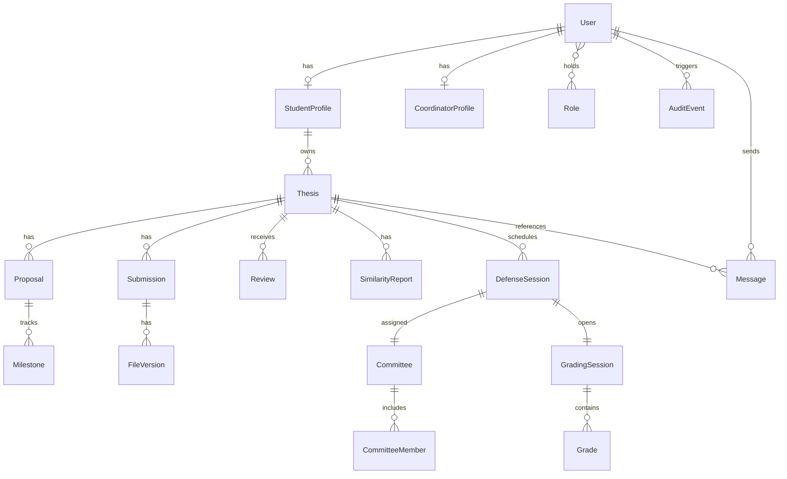

# Data model

The target data model uses stable identifiers, timestamps, explicit ownership, and foreign keys for every relationship. Enumerated workflow values are validated at the application boundary and in the database where practical. The entities below are requirements for the ideal system, not a claim that the current repository already has a completed schema.

## Core entities

| Entity | Purpose |
|--------|---------|
| User | Identity, profile, institutional email, and account status |
| Role | Student, coordinator, committee member, committee president, secretary, or administrator |
| Thesis | The canonical record for a student's thesis lifecycle |
| Topic proposal | Proposed title, abstract, keywords, supervisor preference, and decision history |
| Milestone | Deadline and completion state for proposal, drafts, submission, and defense |
| File and file version | Metadata for uploaded PDFs, ZIP archives, attachments, and generated documents |
| Review | Supervisor or committee feedback, including chapter-level annotations |
| Similarity report | Similarity-check request, provider metadata, score, and review outcome |
| Defense session | 20-minute date and slot, location or meeting link, status, and assigned committee |
| Grade | Per-criterion committee scores, comments, and final result |
| Message | Private conversation content and attachment references |
| Audit event | Actor, action, target, timestamp, and relevant change metadata |

## Relationships

- A user may hold more than one role, subject to institutional policy.
- A thesis belongs to a student and may have one or more supervisors.
- A thesis can have many proposal revisions, milestones, file versions, reviews, and messages.
- A defense session has one committee with multiple members and produces multiple grades.
- Files are referenced by domain records but stored in object storage.
- Audit events reference the actor and target without replacing the domain record's authoritative state.

## Integrity requirements

Use transactions for approval, assignment, submission, scheduling, and grade finalization. Coordinator capacity must be protected by an atomic conditional update so two concurrent approvals cannot exceed the configured 5–7 student quota. Enforce unique constraints for institutional identities, active defense assignments, and immutable version numbers. Prefer soft deletion or retention states for records needed for audit and institutional reporting.
