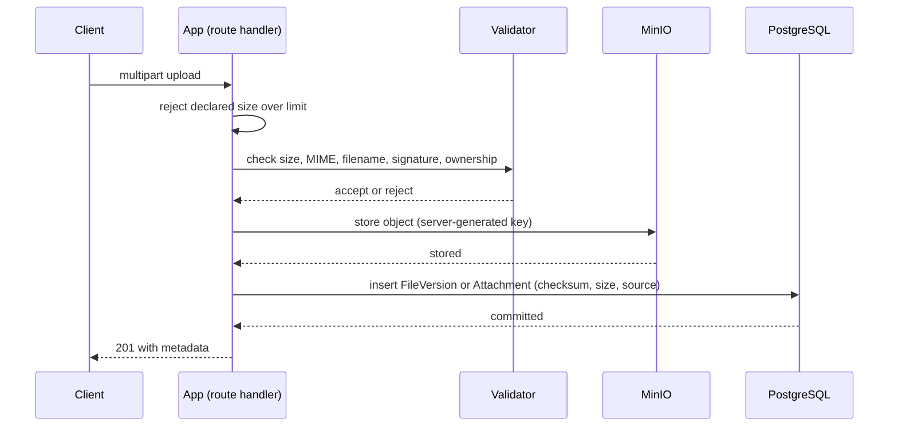
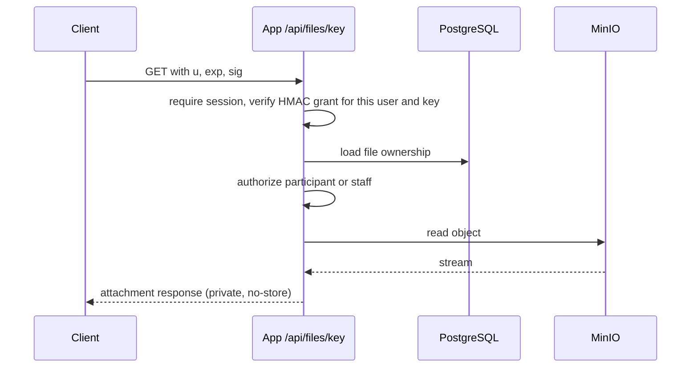

# File storage

The target system stores profile photos, thesis PDFs, ZIP archives, message attachments, assignment PDFs, supervisor reports, and defense minutes in private MinIO-compatible buckets. PostgreSQL stores ownership, versions, checksums, MIME type, size, source workflow record, and retention metadata. Uploads accept only the documented formats and reject files larger than 50 MB.

## Upload flow

File uploads go through route handlers (`/api/submissions`, `/api/messages`, `/api/supervisor-reports`) rather than server actions, so an oversized body can be refused from its `Content-Length` before it is read.

If the insert fails, the stored object is deleted. Object keys look like `submissions/<thesisId>/<uuid>.pdf`, `messages/<conversationId>/<uuid>.zip`, or `reports/<thesisId>/<uuid>.pdf`. The user's file name is stored as metadata and never used in a key.

## Download flow

MinIO is not reachable from browsers, so downloads go through a signed-download proxy.

Pages create links with `createDownloadUrl`: an HMAC-SHA256 grant over key, user id, and expiry, valid for 5 minutes and usable only by the user it was issued to. The route also requires a session and checks the database record before streaming, so a leaked link is useless to anyone else. A stale link needs a page reload.

| File | Who may download |
|---|---|
| Submission version | Thesis student, thesis coordinator, administrator, secretary |
| Supervisor report | Thesis student, thesis coordinator, administrator, secretary |
| Message attachment | The two conversation participants only |

Keys must match `^[a-z0-9][a-z0-9/_.-]*$` without `..` or `//`. Other file kinds (assignment PDFs, minutes, dossier items) need their own lookup in `findFileAccessContext` before they can be served. File contents must not appear in logs. Version numbers are immutable so a final submission can be locked without losing its history.
