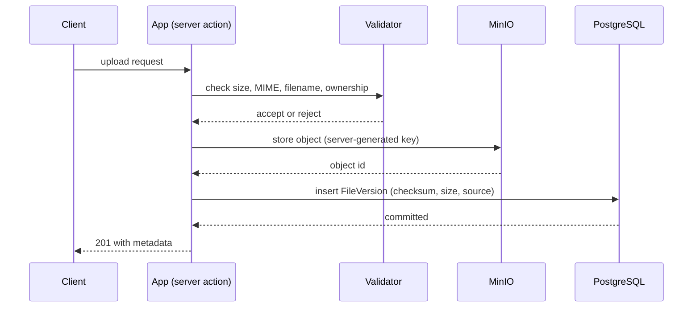
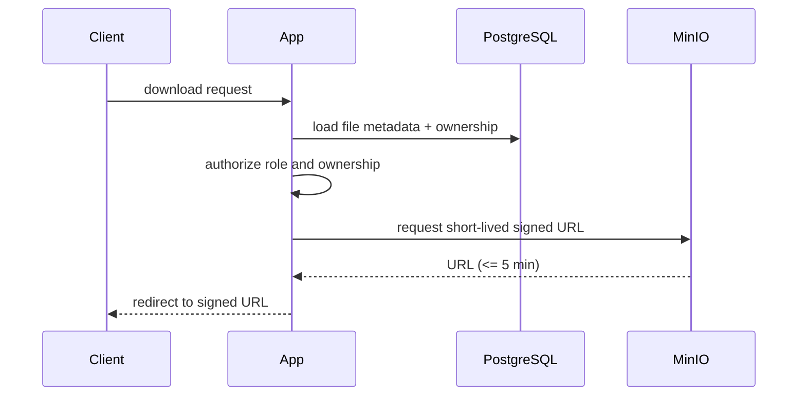

# File storage

The target system stores profile photos, thesis PDFs, ZIP archives, message attachments, assignment PDFs, and defense minutes in private MinIO-compatible buckets. PostgreSQL stores ownership, versions, checksums, MIME type, size, source workflow record, and retention metadata. Uploads accept only the documented formats and reject files larger than 50 MB.

## Upload flow

## Download flow

Downloads use short-lived signed URLs or a signed-download proxy after a server-side ownership or role check. Object keys must not be exposed as authorization decisions, and file contents must not appear in logs. Version numbers are immutable so a final submission can be locked without losing its history.
