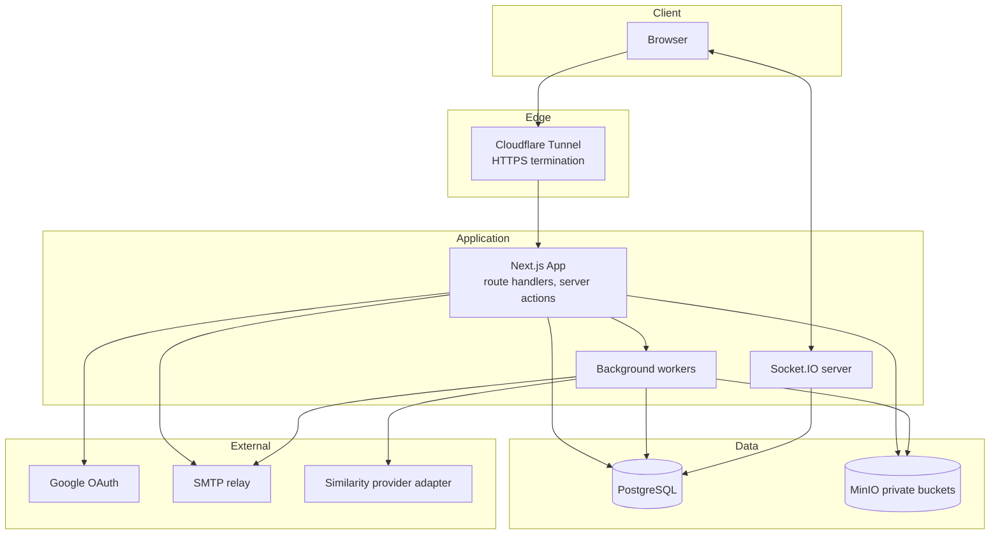

# High-level architecture

The target implementation uses Next.js App Router as a thin route layer. Feature modules contain use-case logic, domain rules, repositories, and presentation components. Shared infrastructure lives under `src/core`. The current source tree provides these locations as scaffolding; a route or module placeholder is not evidence that its use case is operational.

PostgreSQL stores workflow state, MinIO stores private files, Socket.IO provides authorized live updates, and background jobs handle notifications, similarity checks, and PDF generation. Server actions and route handlers validate role permissions before mutation, commit the transaction, and emit events only after a successful commit.

## Container diagram

## External connections

Google OAuth authenticates university accounts, SMTP sends lifecycle notifications, and Cloudflare Tunnel terminates HTTPS without exposing internal container ports. File downloads pass through a server-side ownership or role check before a short-lived signed URL is issued.
