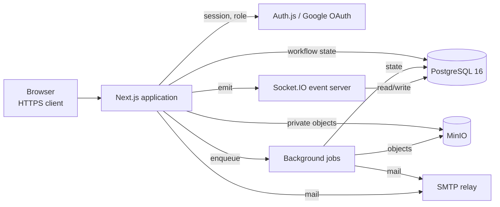

# Architecture

## System overview

This is the target architecture for a role-aware Next.js application. The repository currently contains the intended module boundaries and dependency declarations, but the end-to-end persistence and workflow behavior still requires implementation.

The web layer owns page rendering, route handlers or server actions, input validation, and session enforcement. PostgreSQL stores workflow state and audit metadata, while private object storage stores binary files. Background jobs handle notifications, similarity checks, and PDF generation without blocking interactive requests.



```text
Browser
   |
Next.js application --- authentication and authorization
   |          \
PostgreSQL    Object storage
   |
Background jobs --- email, similarity checks, document generation
```

## Design principles

- Model the thesis lifecycle explicitly rather than inferring state from unrelated records.
- Enforce authorization on the server for every read and mutation.
- Keep binary content out of PostgreSQL while storing ownership, versions, checksums, and access metadata in the database.
- Make deadline, approval, grading, and file transitions auditable.
- Prefer idempotent jobs and transactional state changes.

## Main boundaries

The domain is organized around identity and roles, topic proposals, thesis supervision, submissions and reviews, defense scheduling, committees, grading, notifications, and audit history. Google OAuth, SMTP, object storage, and similarity analysis are external boundaries and should remain behind adapters so they can be replaced or tested independently.

See the [data model](data-model.md) for the core entities.
