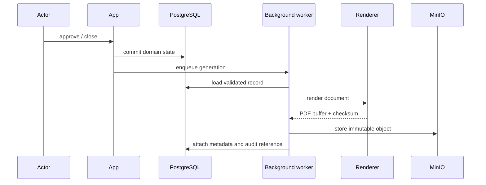

# PDF generation

The target PDF services render signed assignment records and committee-approved defense minutes from validated domain data. Assignment PDFs are generated when a proposal is approved. Defense minutes are generated when the committee president closes the grading session and approves the computed result. Generated files receive immutable metadata, a source record, a checksum, and an audit reference before private storage.

## Generation flow

The renderer must fail without producing a misleading document when required student, committee, grade, or approval data is missing. PDF generation belongs in background work when rendering could delay the interactive transaction; the workflow records a retryable generation state and notifies the responsible administrator if a retry fails.
