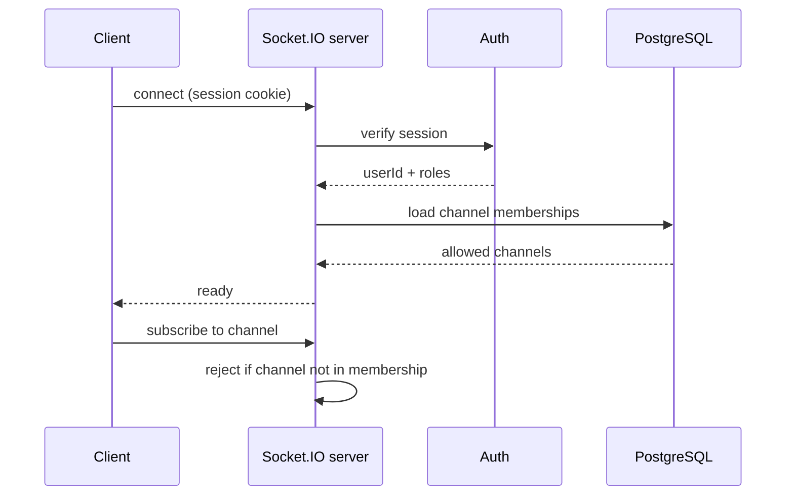

# Real-time events

The target Socket.IO server publishes live messaging, coordinator-capacity changes, proposal decisions, defense-session controls, and gradebook updates. The server authenticates the socket, derives channel membership from database permissions, and rejects client-controlled channel names that would broaden access.

## Connection flow

## Event catalog

| Event | Publisher | Payload | Audience |
|---|---|---|---|
| `proposal.decided` | Route handler | proposal id, state | Student, coordinator |
| `capacity.changed` | Route handler | coordinator id, remaining | Authorized students |
| `message.created` | Route handler | message id, conversation | Conversation members |
| `message.read` | Route handler | message id, reader | Sender |
| `defense.slot.changed` | Route handler | session id, slot | Committee, secretary |
| `gradebook.updated` | Route handler | session id, mean | Committee, president |
| `gradebook.closed` | Route handler | session id, result | Committee, student |

Events are emitted after the transaction that changes the source record commits. Message events include delivery and read state; active conversations may include typing indicators. Gradebook events carry only the authorized session state and the computed average needed by participants. Offline recipients receive email alerts for unread messages instead of relying on a socket connection.
