# Thesis workflow

The target lifecycle has three stages. Topic approval covers coordinator selection, proposal submission, capacity-aware assignment, and approval. Supervision covers milestones, private messages, versioned drafts, chapter review, similarity analysis, and the coordinator report. Defense covers final dossier verification, 20-minute slot assignment, committee grading, minutes approval, and result notification.

## Stage diagram

```mermaid
flowchart LR
	subgraph Approval
		A1[Coordinator discovery] --> A2[Proposal submission]
		A2 --> A3[Decision]
		A3 --> A4[Assignment PDF]
	end
	subgraph Supervision
		B1[Milestones] --> B2[Drafts and reviews]
		B2 --> B3[Similarity check]
		B3 --> B4[Coordinator report]
	end
	subgraph Defense
		C1[Dossier verification] --> C2[20-minute slot]
		C2 --> C3[Committee grading]
		C3 --> C4[Minutes approval]
		C4 --> C5[Result email]
	end
	A4 --> B1
	B4 --> C1
```

## State transitions

Proposal records move through draft, submitted, revision requested, approved, and rejected states. A coordinator cannot accept a proposal after reaching the configured capacity, and an approval decrements remaining capacity atomically. A final submission becomes immutable for defense preparation. A grading session moves from open to closed; closing prevents further score edits, computes the mean, generates the minutes PDF, and sends results.

Each transition must be authorized, validated, transactional where necessary, and auditable. Invalid transitions return a clear domain error rather than silently changing a record.

## Transition matrix

| From | To | Actor | Precondition | Side effect |
|---|---|---|---|---|
| `draft` | `submitted` | Student | Proposal complete | Notify coordinator |
| `submitted` | `revision requested` | Coordinator | Reason recorded | Notify student |
| `submitted` | `approved` | Coordinator | `capacity > 0` (atomic) | Increment count, generate assignment PDF |
| `submitted` | `rejected` | Coordinator | Reason recorded | Notify student |
| `open` | `closed` | President | Mean computed, minutes approved | Lock grades, generate PDF, email results |
