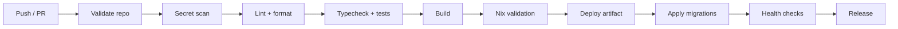

# CI/CD

The repository's GitHub Actions quality workflow runs repository validation, secret scanning, source-policy checks, formatting, linting, type checking, tests, builds, and Nix validation. The package scripts define the JavaScript checks. Dependabot is a target dependency-management control and is not asserted as present until its configuration is committed.

## Pipeline

