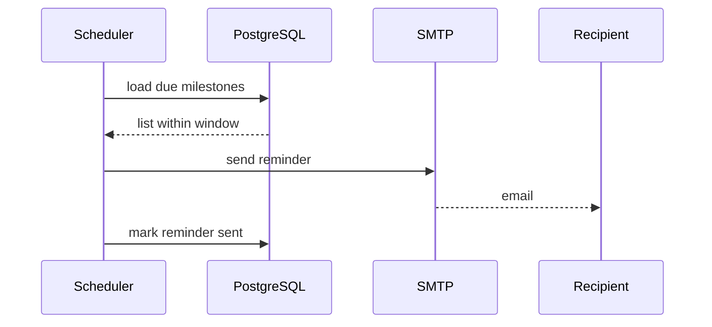

# Approval and deadlines

Coordinators approve, reject, or request revisions with an auditable decision reason. Approval decrements available capacity atomically and generates a signed assignment PDF. The student and coordinator maintain milestones for proposal, drafts, final submission, and defense. Deadline reminders are sent through SMTP, while late or blocked milestones remain visible to responsible roles.

## Milestone set

| Milestone | Owner | Reminder |
|---|---|---|
| Proposal submitted | Student | 3 days before |
| Chapter drafts | Student | per chapter deadline |
| Final submission | Student | 7 days before lock |
| Defense | Coordinator | per schedule |

## Reminder flow

