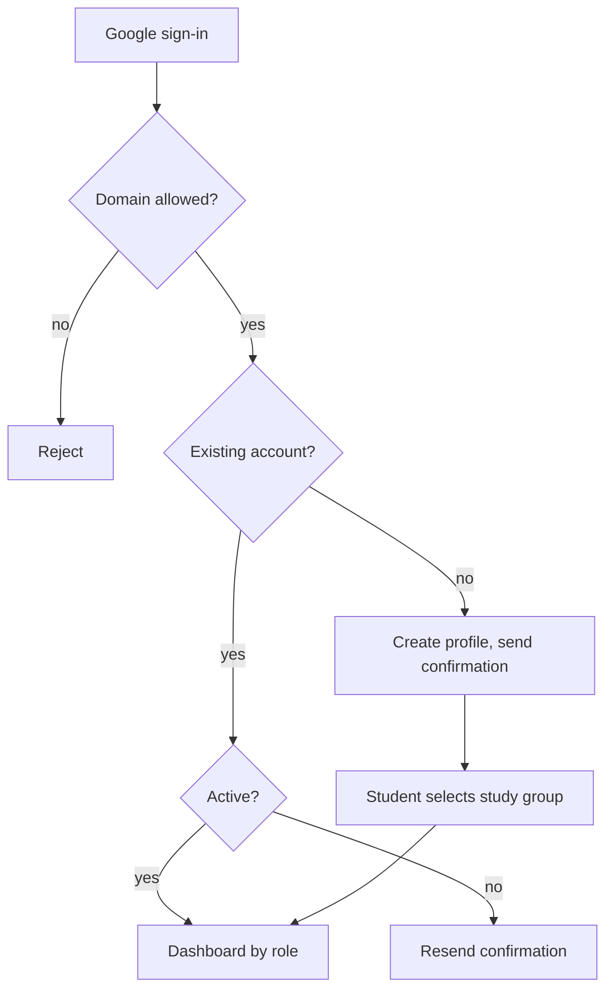

# Authentication and profile

The target identity flow authenticates university accounts through Auth.js and Google OAuth. Demonstration accounts may use password login without weakening production university-domain checks. Registration sends a confirmation email before the account becomes fully active.

## Onboarding flow

Students select their study group during onboarding. Coordinators configure research areas and a 5–7 student supervision quota. Profiles expose only fields needed by authorized workflows, and server-side guards enforce student, coordinator, committee member, committee president, secretary, and administrator permissions on every read and mutation.
