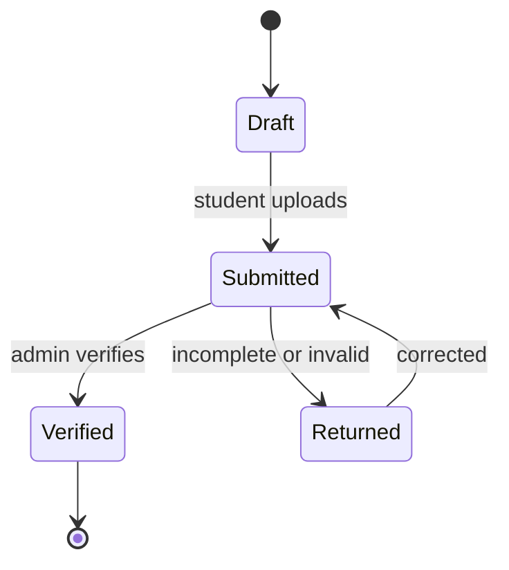

# Defense file

The defense file is a checklist-backed dossier containing the locked final thesis, coordinator report, similarity report, assignment and approval records, and other institution-required documents. Students upload missing student-owned documents; administrators verify completeness and return the dossier for correction when a requirement is absent or invalid. A defense cannot proceed until the dossier reaches a verified state, and every verification or correction is audited.

## Dossier lifecycle

## Checklist

| Item | Owner | Required | State Model |
|---|---|---|---|
| Locked final thesis | Student | yes | `FINAL_THESIS` |
| Coordinator report | Coordinator | yes | `COORDINATOR_REPORT` |
| Similarity report | System | yes | `SIMILARITY_REPORT` |
| Assignment and approval record | System | yes | `APPROVAL_RECORD` |
| Institutional documents | Student / admin | per policy | `INSTITUTIONAL_DOC` |

## Implementation modules

- Domain state machine: `src/features/defense/domain/defense-file.ts` (`transitionDossierState`, `canVerifyDossier`)
- Data repository: `src/features/defense/data/dossier-repository.ts` (`DossierRepository`)
- Server actions: `src/features/defense/actions.ts` (`submitDossierAction`, `verifyDossierAction`, `returnDossierAction`, `updateDossierItemStatusAction`)
- Presentation: `src/features/defense/presentation/dossier-checklist.tsx`
- Administration routes: `src/app/(admin)/dossiers/page.tsx`
