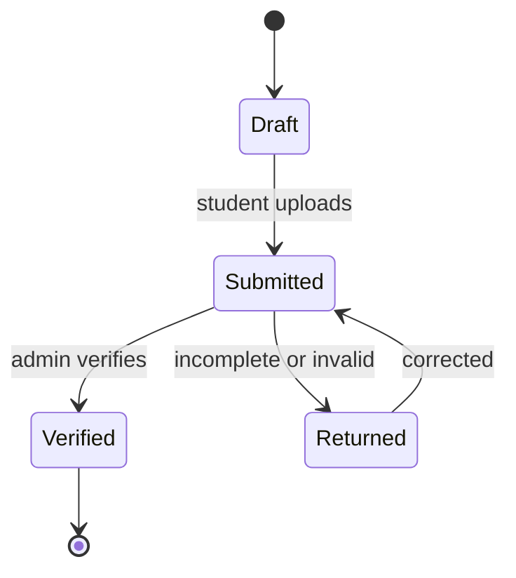

# Defense file

The defense file is a checklist-backed dossier containing the locked final thesis, coordinator report, similarity report, assignment and approval records, and other institution-required documents. Students upload missing student-owned documents; administrators verify completeness and return the dossier for correction when a requirement is absent or invalid. A defense cannot proceed until the dossier reaches a verified state, and every verification or correction is audited.

## Dossier lifecycle

## Checklist

| Item | Owner | Required |
|---|---|---|
| Locked final thesis | Student | yes |
| Coordinator report | Coordinator | yes |
| Similarity report | System | yes |
| Assignment and approval record | System | yes |
| Institutional documents | Student / admin | per policy |
