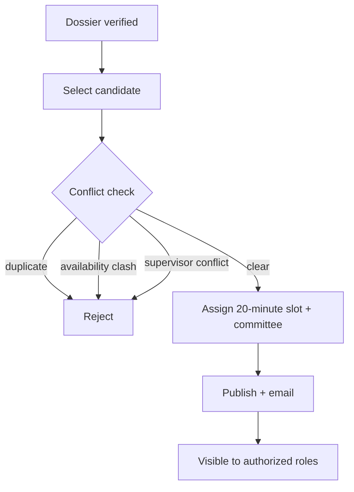

# Defense scheduling

Secretaries and administrators assign 20-minute defense slots and committees after the defense file reaches the required readiness state. The scheduler checks participant availability, duplicate assignments, and supervisor or committee conflicts before publication. Administrators may reorder candidates before finalization. Published schedules are emailed and visible only to authorized students, coordinators, committee members, and administrators.

## Scheduling flow

## Slot invariants

- Each slot is exactly 20 minutes.
- A committee member cannot hold two simultaneous slots.
- A supervisor cannot serve on their own student's committee.
- Published schedules are immutable; changes go through an audited reschedule flow.
