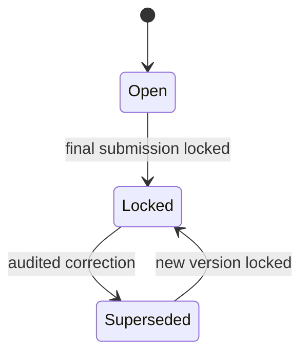

# Files and submissions

Students upload versioned thesis PDFs and ZIP archives against conversations or milestones. Upload validation rejects unsupported formats and files over 50 MB before storage. Submission records preserve owner, version, checksum, MIME type, size, review state, source milestone, and final-lock state. A locked final submission remains downloadable to authorized participants but cannot be replaced through the ordinary upload path.

## Locking rule

## Validation

| Check | Rejection |
|---|---|
| Size > 50 MB | `upload_too_large` |
| MIME outside allow-list | `unsupported_format` |
| Filename with path separators | `invalid_filename` |
| Owner mismatch | `forbidden` |
