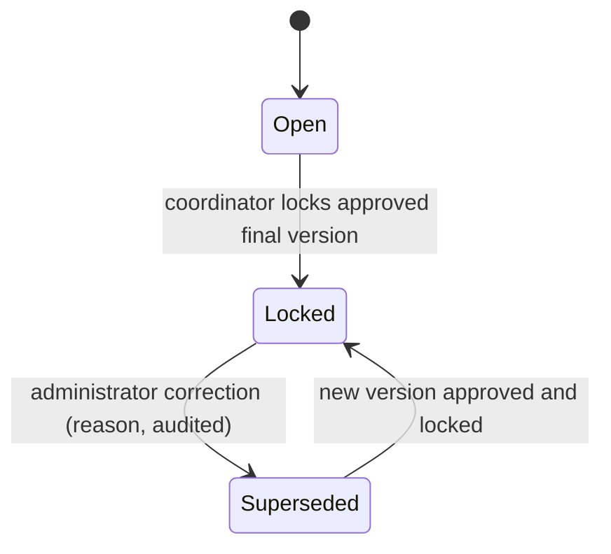

# Files and submissions

Students upload versioned thesis PDFs and ZIP archives against a milestone or as a standalone draft. Each upload is a `FileVersion` of a `Submission`. Version numbers start at 1, increase by one, and are unique per submission. A version records the uploader, checksum, MIME type, size, and server-generated object key. The owner is the student of the thesis, the review state is derived from the newest review of the latest version, and the source milestone is optional.

Uploads are sent to `POST /api/submissions` as multipart form data. The route rejects a declared body larger than the limit before reading it, and the service validates the file again before anything reaches storage. A locked final submission stays downloadable to authorized participants but cannot receive new versions.

## Locking rule

| Action | Actor | Precondition |
|---|---|---|
| Upload version | Thesis owner | Submission is `Open` or `Superseded` |
| Lock | Supervising coordinator | Latest version has an approving review |
| Supersede | Administrator or secretary | Reason of at least 10 characters. The transition is written to the audit log. |

Locking and uploading serialize on the submission row, so an upload that races a lock is rejected with `submission_locked`.

## Validation

Checks run in this order, and the first failure is returned.

| Check | Rejection |
|---|---|
| Size > `MAX_UPLOAD_BYTES` (50 MB) | `upload_too_large` |
| Empty file | `validation_failed` |
| Filename empty, over 255 characters, containing `/`, `\`, `..`, or control characters | `invalid_filename` |
| Extension and MIME type outside the PDF and ZIP allow-list | `unsupported_format` |
| File content does not start with the PDF or ZIP signature | `unsupported_format` |
| Uploader is not the thesis owner | `forbidden` |
| Submission is locked | `submission_locked` |

A rejected upload stores nothing. If the database write fails after the object was stored, the object is removed.
