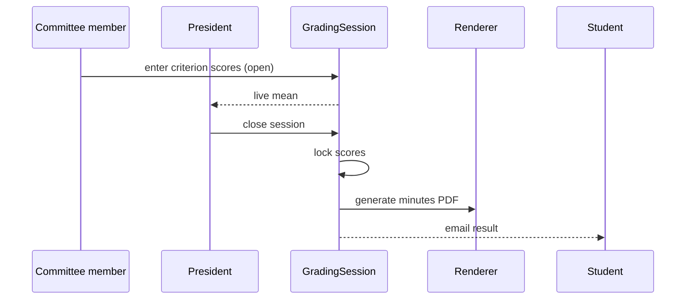

# Live gradebook

The committee gradebook opens a controlled session for a scheduled defense. Committee members enter rubric scores independently, while authorized participants see the current mean without seeing another member's private draft values unless policy permits it. The committee president reviews the computed average, closes the session, and approves the defense minutes. Closing locks scores, generates the minutes PDF, and emails results; subsequent corrections require an audited administrator process.

## Grading flow

## Mean computation

The computed mean follows the rubric weights:

$$
\bar{g} = \frac{\sum_{i} w_i \cdot g_i}{\sum_{i} w_i}
$$

When rubric weights are equal (or default 1.0), this calculation reduces to the arithmetic mean across all committee members on the 1.00–10.00 scale.

## Implementation modules

- Domain models & calculations: `src/features/grading/domain/grade.ts` (`validateGradeValue`), `src/features/grading/domain/grading-session.ts` (`computeLiveMean`, `canCloseGradingSession`), `src/features/grading/domain/minutes.ts`
- Data repositories: `src/features/grading/data/grading-repository.ts`, `src/features/grading/data/minutes-repository.ts`
- Minutes PDF builder: `src/core/pdf/minutes.tsx` (`DefenseMinutesDocument`, `generateDefenseMinutesDocument`)
- Server actions: `src/features/grading/actions.ts` (`submitGradeAction`, `closeGradingSessionAction`)
- Presentation: `src/features/grading/presentation/grade-entry.tsx`, `src/features/grading/presentation/live-average.tsx`, `src/features/grading/presentation/session-controls.tsx`
- Routes: `src/app/(coordinator)/gradebook/page.tsx`, `src/app/(student)/results/page.tsx`
