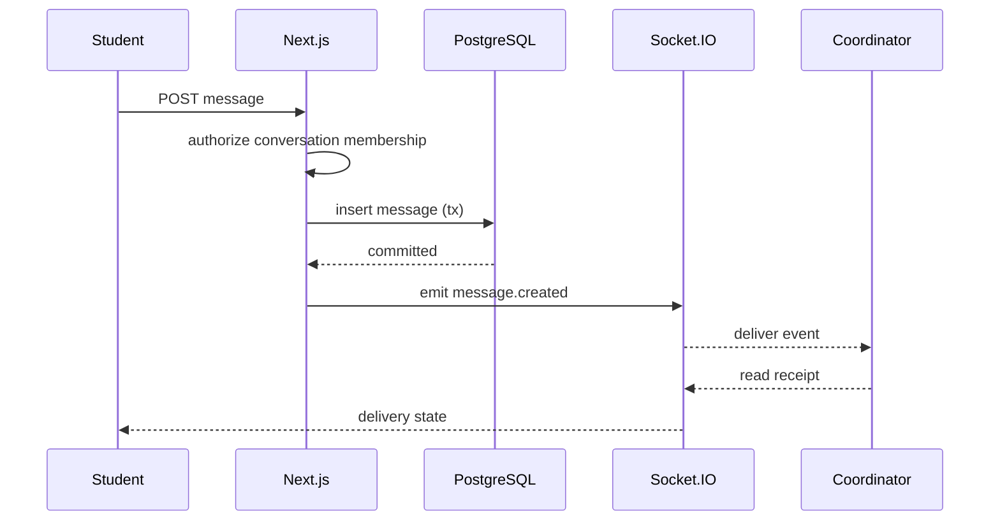

# Private messaging

The target private conversation is limited to the assigned student and coordinator, with authorized attachments, message timestamps, read receipts, and typing indicators. Socket events are scoped to conversation membership. Offline recipients receive email alerts for unread messages, while the message remains the authoritative record in PostgreSQL.

