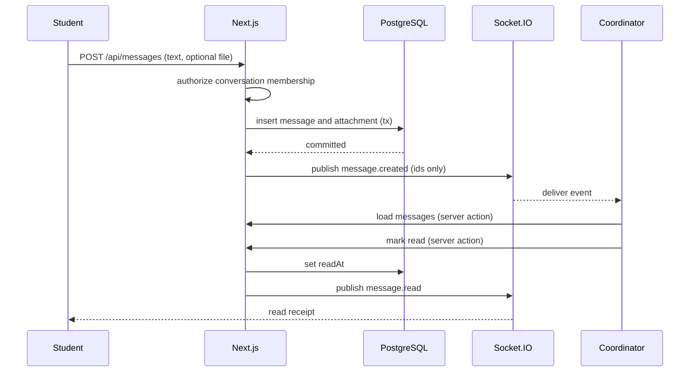

# Private messaging

A private conversation exists per thesis once a coordinator is assigned. Only the student and the supervising coordinator are participants. Messages carry timestamps, optional PDF or ZIP attachments, read receipts, and typing indicators. The message row in PostgreSQL is the authoritative record; socket events carry only identifiers, and clients fetch message content through an authorized server action.

## Rules

| Rule | Behavior |
|---|---|
| Membership | Sending, loading, and marking read require a `ConversationParticipant` row, otherwise `forbidden`. |
| Opening | The conversation is created on first load once `Thesis.coordinatorId` is set. One conversation per thesis (unique `thesisId`). |
| Content | Trimmed text up to 2000 characters, or an attachment, or both. |
| Attachments | PDF or ZIP up to 50 MB, validated before storage. Downloads use signed, user-bound links and are limited to the two participants. |
| Read receipts | Opening a conversation marks the other participant's unread messages read and publishes `message.read` with the message ids. |
| Typing | The client emits `typing` on the socket. The server relays `message.typing` only to other sockets subscribed to the same conversation. Nothing is stored. |
| Offline alert | If no other participant has a socket in the conversation when a message is published, the recipient gets one email with the sender and thesis title, never the message text. A further alert is sent only after the earlier alerted message has been read. |

If the event server is unreachable, publishing is skipped and the recipient is treated as offline, so the email alert still goes out.
