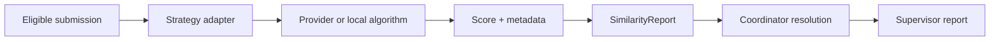

# Review and similarity

Coordinators review chapter drafts with anchored annotations, review decisions, and revision requests. A similarity job compares an eligible submission with stored theses through a replaceable strategy adapter. The report records provider or algorithm metadata, score, input version, completion state, and coordinator resolution without broadly exposing source documents. The coordinator submits a supervisor report once the required review and similarity work is complete.

## Similarity pipeline

## Report fields

| Field | Description |
|---|---|
| `provider` | Adapter or algorithm identifier |
| `metadata` | Provider-specific version and options |
| `score` | Numeric similarity score |
| `inputVersion` | Submission version analyzed |
| `state` | `pending`, `complete`, `failed` |
| `resolution` | Coordinator decision and notes |
