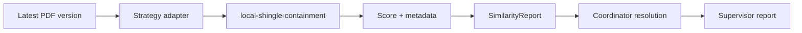

# Review and similarity

The supervising coordinator reviews the latest version of a draft. A review records a decision (`APPROVED`, `CHANGES_REQUESTED`, `REJECTED`), optional feedback, and up to 30 anchored annotations (chapter, optional page, optional quoted passage, comment). Reviews are append-only, so the history stays visible to the student. A review must target the latest version, and a locked submission cannot be reviewed. A decision other than approval needs feedback or at least one annotation.

A similarity check compares the latest PDF version with the latest version of every submission from other theses. Text extraction (`pdf-parse`) happens at upload and is cached on the file version. The comparison goes through a `SimilarityStrategy`, so the algorithm can be replaced without touching the service. The shipped strategy, `local-shingle-containment`, splits normalized text into 5-word shingles and reports the share of the submission's shingles found in any stored document.

## Similarity pipeline

The report stores scores and match percentages only. Source documents and their owners are never shown. Students do not see similarity reports.

## Report fields

| Field | Description |
|---|---|
| `provider` | Strategy identifier |
| `metadata` | Algorithm version, shingle size, corpus size, top match ratios |
| `score` | Percentage of the submission's text found elsewhere (0 to 100) |
| `inputVersion` | Version analyzed. A newer version makes the report stale. |
| `state` | `PENDING`, `COMPLETED`, `FAILED` |
| `resolution` | `ACCEPTED` or `REJECTED`, plus notes. Notes are required for `REJECTED`. |

Running the check again resets the report and clears any earlier resolution. A document with too little text, or one that cannot be read, ends in `FAILED` with a reason.

## Supervisor report

The coordinator uploads the supervisor report (PDF) for the thesis once the locked final submission has an approving review on its latest version and a completed, accepted similarity check for that same version. Until then the page lists what is missing. Submitting again replaces the file. Every submission is audited.
