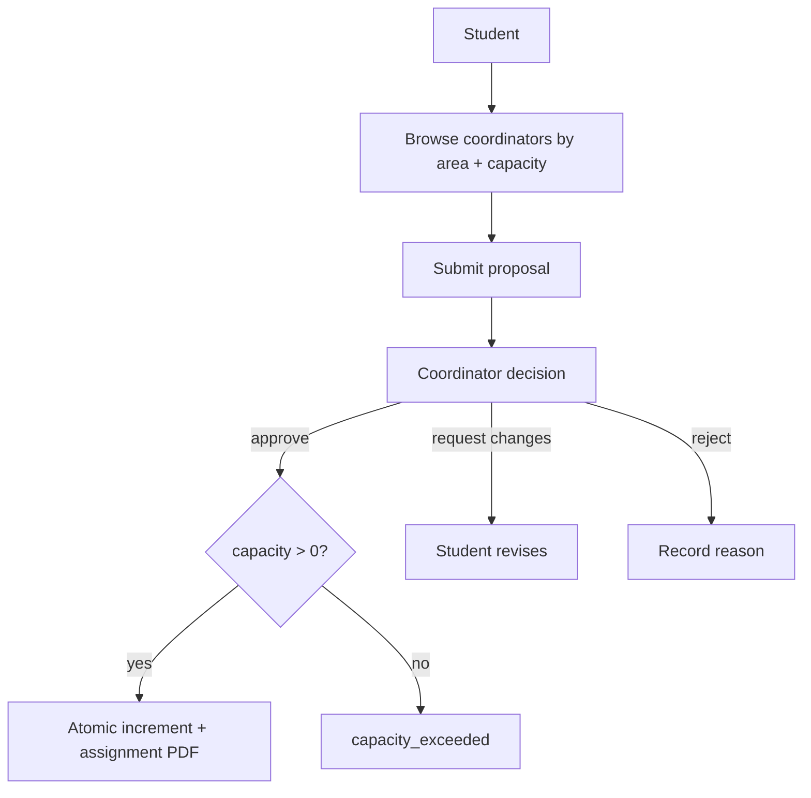

# Topic proposal

Students browse coordinators by research area and remaining capacity, then submit a structured proposal containing a title, abstract, keywords, and supervision choice. Coordinators approve, reject, or request revisions. Every decision records the actor, time, reason, and proposal revision.

Capacity is a concurrency boundary, not a display-only number. Approval succeeds only when the coordinator remains below the configured 5–7 student quota; the database update and proposal transition commit atomically. Remaining capacity and proposal decisions are published to authorized clients after commit.

## Decision record

| Field | Description |
|---|---|
| `actorId` | Coordinator user id |
| `decidedAt` | Timestamp |
| `reason` | Required for reject and request-changes |
| `revision` | Proposal revision at decision |
| `result` | `approved`, `rejected`, `revision_requested` |
