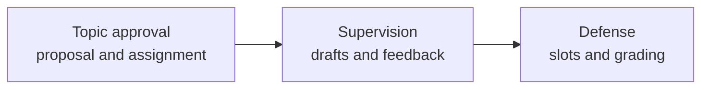

# Thesis Coordinator documentation

Thesis Coordinator is the target system for managing a bachelor thesis from coordinator selection and topic approval through supervision, defense scheduling, and final grading. It replaces email threads and spreadsheets with a role-aware workflow for students, coordinators, committee members, committee presidents, secretaries, and administrators.

## Documentation status

The product requirements and target architecture in these pages follow `thesis_coordinator.pdf`. The repository is a development scaffold: package metadata, route structure, feature boundaries, shared infrastructure modules, and documentation exist, while most runtime workflows remain to be implemented. Statements about planned behavior are labeled as target requirements; they are not claims that the current checkout already provides the behavior.

## Product stages

| Stage | Scope | Entry | Exit |
|---|---|---|---|
| Topic approval | Coordinator discovery, capacity, proposal submission, approval, revision requests, assignment record | Student onboarding | Approved proposal with assignment PDF |
| Supervision | Milestones, private messaging, versioned drafts, chapter reviews, similarity checks, coordinator report | Approved assignment | Locked final submission and supervisor report |
| Defense | Dossier verification, 20-minute slots, committee grading, minutes approval, result notification | Verified dossier | Closed grading session and emailed results |

## Technology baseline

| Layer | Technology |
|---|---|
| UI and server | Next.js 15, React, TypeScript, Tailwind CSS, shadcn/ui, Zod |
| Identity | Auth.js with Google OAuth |
| Persistence | PostgreSQL 16, Prisma ORM |
| Real-time events | Socket.IO, Node.js |
| File and PDF handling | MinIO, `@react-pdf/renderer`, `pdf-parse` |
| Notifications | Nodemailer over SMTP |
| Deployment | Docker Compose, Cloudflare Tunnel, GitHub Actions, Nix |

## Documentation map

| Audience | Start here |
|---|---|
| New contributor | [Getting started](../README.md#documentation) -> installation, configuration, local workflow |
| Implementer | Architecture -> data model, schema, workflow, real-time, storage |
| Reviewer | Features -> one page per use case |
| Operator | Operations -> backups, CI/CD |
| Security reviewer | Security and compliance -> security, privacy |

Use the [README documentation index](../README.md#documentation) to browse the pages by audience and workflow.
