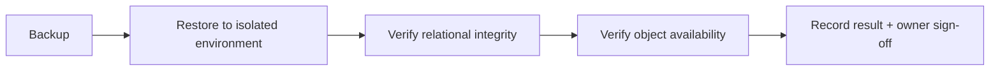

# Backups

The target operations plan backs up PostgreSQL on a tested schedule and retains object-storage versions for important submissions, generated PDFs, and audit-relevant files. Restrict backup access, encrypt backups, monitor failures, and perform restoration drills that verify both relational records and object availability. A backup policy is not complete until recovery objectives, retention periods, and an owner are recorded by the institution.

## Schedule

| Target | Frequency | Retention | Verification |
|---|---|---|---|
| PostgreSQL | Nightly | 30 days + monthly archive | Weekly restore drill |
| MinIO versions | Continuous | Per institutional policy | Monthly object availability check |
| Audit exports | Weekly | 1 year | Quarterly review |

## Restoration drill

