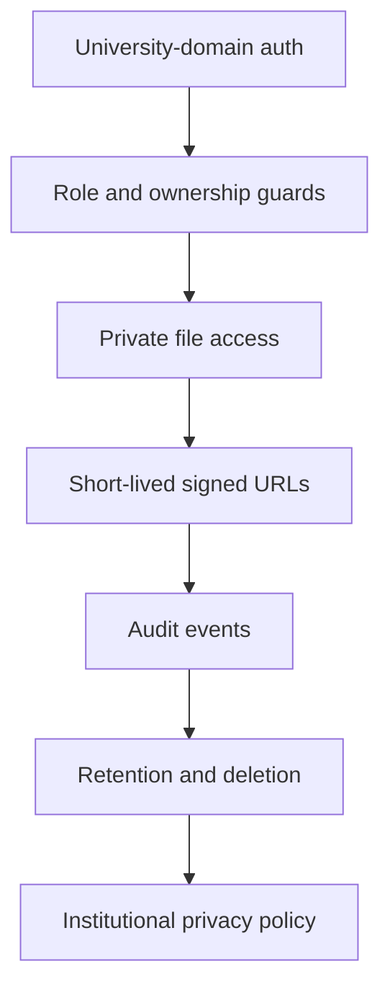

# Security and compliance

The target security model covers university-domain authentication, role and ownership guards, private file access, auditability, secret handling, data minimization, retention, and institutional privacy obligations. These pages describe required controls; the scaffold does not yet establish that each control is implemented.

## Control map

